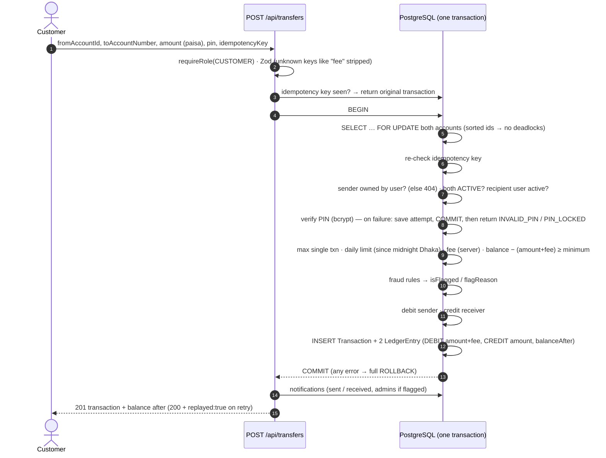
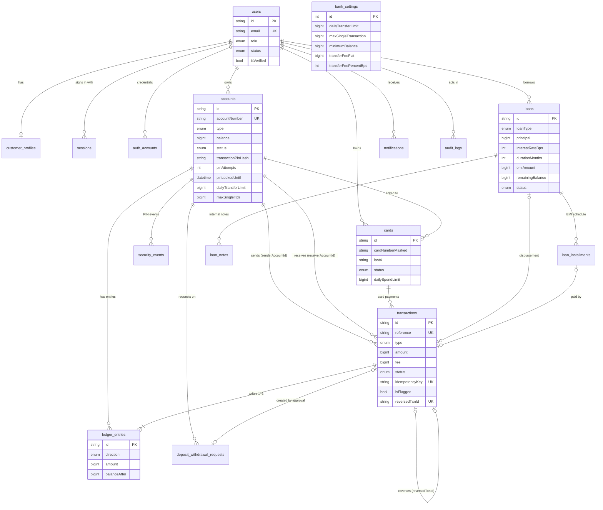

# Kosh — Digital Banking Management System

> **Simulated bank — no real money, cards or accounts.** Built as an assessment project.

Kosh is a full-stack digital bank with three roles — **Customer, Staff, Admin** — built on **Next.js 15 (App Router) · TypeScript · Redux Toolkit + RTK Query · Prisma · PostgreSQL (Neon) · Better Auth · HeroUI v3 · Tailwind CSS 4 · Recharts**.

The priority is **correct, atomic, server-enforced banking logic**: every transfer locks both accounts, re-checks every rule on the server, and writes the debit and credit together or not at all. History is never edited; mistakes are corrected with compensating transactions.

- **Live demo:** [kosh-banking-app.vercel.app](https://kosh-banking-app.vercel.app)
- **Repository:** [sultanafardhowsy/kosh_banking_app](https://github.com/sultanafardhowsy/kosh_banking_app)

---

## Demo credentials

| Role | Email | Password | Notes |
|---|---|---|---|
| **Customer** | `customer@kosh.demo` | `Demo@1234` | Nusrat Jahan — 3 accounts (savings, current, business), active loan, virtual card, 6 months of history |
| **Staff** | `staff@kosh.demo` | `Demo@1234` | Tanvir Ahmed — approvals, KYC, card requests |
| **Admin** | `admin@kosh.demo` | `Demo@1234` | Farhana Islam — everything, incl. loan decisions, reversals, settings |
| Customer 2 | `rafi@kosh.demo` | `Demo@1234` | A second customer to send money to |
| Staff 2 | `staff2@kosh.demo` | `Demo@1234` | |

**Transaction PIN for every seeded account: `1234`.** The login page has one-click demo buttons.
Sign-in requests are rate-limited by Better Auth (30 requests per 60 seconds).

**Things to try:** send money as the customer (try a wrong PIN first) → sign in as staff and approve a pending deposit → as admin, review a flagged transaction and reverse it, approve the loan under review (watch the disbursement and EMI schedule appear), freeze an account, change the transfer fee and see it on the next transfer.

---

## Application features

**Customer**
- Dashboard with account switcher, balances, 3 charts (monthly spending, monthly deposits, transaction mix), recent activity and virtual card
- Accounts and per-account **ledger statements**; **PDF and CSV statement export**
- **4-step transfer**: details → server-side review (fee, total, balance after, remaining daily limit) → PIN → receipt
- Transaction history with search, type/status/account/date filters and pagination; detail with both ledger lines; **PDF receipts**
- Deposit and withdrawal **requests** (approved by staff)
- **Loans**: product-based application wizard with live EMI calculator, status timeline, full amortisation schedule, PIN-protected EMI repayment
- **Virtual cards (simulated)**: request, freeze/unfreeze, own daily limit, simulated merchant payments
- Notifications (bell with unread count, mark read / all, email on/off), profile with KYC self-service, per-account PIN set/change, optional Google sign-in
- Two-factor: an emailed one-time code confirms large transfers and PIN changes

**Staff**
- Work-queue overview (pending requests, new loans, KYC, today's transactions, open flags)
- Register customers (temporary password shown once), verify KYC, open accounts
- Search all accounts and all transactions; manually flag suspicious transactions
- Approve/reject deposit & withdrawal requests (never their own)
- Review loans: internal notes, forward to admin
- Approve/reject card requests, freeze cards
- Bell alerts for every new item in their queues

**Admin**
- Bank-wide overview: KPIs + 5 charts (monthly volume, deposits vs withdrawals, monthly activity, account distribution, loan statistics)
- Activate / deactivate / block users (blocked users are signed out everywhere)
- Freeze / unfreeze / close accounts; per-account transfer limits
- Approve (disburse + schedule) or reject loans
- Flagged-transaction review: clear the flag or **reverse** the transaction
- Bank settings (limits, minimum balance, fees) with live fee preview
- Audit log of every staff/admin action; permanent card blocking
- Email log: every notification email with status and a preview
- Two-factor on reversals and settings changes; set the transfer amount that needs a code

**Everywhere:** light mode (default) and dark mode, responsive down to 375 px (tables become cards, customer bottom tab bar), skeleton loaders, empty states, toasts, confirmation dialogs with required reasons for sensitive actions.

---

## User roles & permissions

Enforced **on the server** in every route handler — the UI only mirrors it.

| Action | Admin | Staff | Customer |
|---|:-:|:-:|:-:|
| Bank-wide dashboard & analytics | ✓ | limited (work queue) | ✗ |
| Register customers / open accounts | ✓ | ✓ | ✗ |
| Verify customer KYC | ✓ | ✓ | ✗ |
| Activate / deactivate / block users | ✓ | ✗ | ✗ |
| Freeze / unfreeze / close accounts, set limits, bank settings | ✓ | ✗ | ✗ |
| View / search all transactions | ✓ | ✓ | own only |
| Flag transactions | ✓ | ✓ | ✗ |
| Reverse transactions | ✓ | ✗ | ✗ |
| Approve deposit / withdrawal | ✓ | ✓ (not own) | ✗ |
| Loan notes / forward | ✓ | ✓ (not own) | ✗ |
| Approve / reject loans | ✓ (not own) | ✗ | ✗ |
| Approve / reject / freeze cards | ✓ | ✓ (not own) | freeze own |
| Block card permanently | ✓ | ✗ | ✗ |
| Transfer, request deposit/withdrawal, apply for loan, pay with card | ✗ | ✗ | ✓ |

---

## Architecture

```
src/
  app/
    page.tsx                        landing page (reads live bank settings)
    (auth)/login, register          public auth pages (signed-in users are redirected)
    (customer)/…                    CUSTOMER area — layout checks the role on the server
    (staff)/staff/…                 STAFF area
    (admin)/admin/…                 ADMIN area
    api/…                           Route Handlers = the backend
  server/
    auth/auth.ts                    Better Auth (bcrypt, server-controlled role/status, blocked-user hook)
    auth/guards.ts                  requireRole · requireUser · assertAccountOwner · assertNotSelf
    services/                       transfer · pin · request · loan · card · management · stats · fraud ·
                                    transaction-admin · customer-query · document · notification · settings · locks
    pdf/documents.tsx               receipts & statements (@react-pdf/renderer)
    http.ts                         handler() wrapper, typed errors → JSON, the ONE BigInt serializer, Zod parsing
    errors.ts                       AppError + typed codes
    db.ts                           Prisma client (Rust-free engine + pg driver adapter)
  store/                            Redux Toolkit store, RTK Query API slices, feature slices
  components/                       ui · layout · banking · loans · cards · review · manage · charts · landing
  lib/                              money (paisa maths) · emi · fees · fraud-rules · time · validators (Zod) · formatting
prisma/  schema.prisma · migrations/ · seed.ts
tests/   unit/ · integration/ (real Postgres) · e2e/ (HTTP)
docs/    plan.md · HANDOFF.md (build log & decisions)
```

---

## Redux Toolkit architecture

- **Store per role area.** `makeStore()` is created once inside a client `StoreProvider` (`useRef`), mounted by each role layout and **hydrated with the server-side session user** — App Router safe (no store shared between requests). Public pages carry no store.
- **One API slice** (`store/api/baseApi.ts`, `fetchBaseQuery({ baseUrl: "/api" })`) with features added through `injectEndpoints`: `meApi`, `accountsApi`, `transactionsApi`, `requestsApi`, `notificationsApi`, `loansApi`, `cardsApi`, `staffApi`, `adminApi`, `statsApi`.
- **Feature slices** (`store/slices/`)

| Slice | State |
|---|---|
| `authSlice` | current user + role (hydrated from the session) |
| `accountSlice` | account chosen in the top-bar switcher (drives dashboard, transfer "from", charts) |
| `transactionSlice` | history filters (account, search, type, status, dates) + page / page size |
| `loanSlice` | multi-step loan application draft + wizard step + selected loan |
| `cardSlice` | selected card + reveal/hide details |
| `uiSlice` | sidebar collapsed, mobile drawer, **global loading** (count of in-flight mutations via `isPending`/`isFulfilled`/`isRejected` matchers) |

- **Centralized errors:** `rtkQueryErrorLogger` middleware turns any rejected call into a toast using the API's typed error code; endpoints whose errors are shown inline in a form are listed in `SILENT_ENDPOINTS`.
- Typed hooks: `useAppDispatch`, `useAppSelector`, `useAppStore`.

## RTK Query implementation

**Tags:** `Me, Account, Transaction, Loan, Request, Stats, Notification, Customer, Settings, Card, Audit` (with ids such as `{type:"Loan", id}` and list ids `LIST / MINE / QUEUE / FLAGGED`).

| Mutation | Invalidates |
|---|---|
| `transfer` | Me, Account, Transaction LIST, Stats, Notification |
| `reviewRequest` (approve/reject) | Request QUEUE & MINE, Account, Transaction LIST, Stats, Audit |
| `applyLoan` | Loan MINE & QUEUE, Notification |
| `repayLoan` | Loan (id, MINE), Me, Account, Transaction LIST, Stats, Notification |
| `decideLoan` (approve/reject) | Loan REVIEW & QUEUE, Account, Transaction LIST, Stats, Audit |
| `payWithCard` | Card MINE, Me, Account, Transaction LIST, Stats, Notification |
| `reverseTransaction` | Transaction FLAGGED & LIST, Account, Customer, Stats, Audit |
| `setUserStatus`, `updateAccount`, `openAccount`, `verifyCustomer` | Customer (id, LIST), Account, Stats, Audit |
| `updateSettings` | Settings, Audit |

Extras: **optimistic** "mark notification read" (`updateQueryData` + undo on failure); **polling** for the notification bell (30 s) and the staff/admin overviews (60 s); `refetchOnFocus` / `refetchOnReconnect` via `setupListeners`.

---

## Authentication strategy

- **Better Auth** with email + password, sessions stored in Postgres (`sessions` table), httpOnly cookie. No cookie cache, so a role or status change applies on the very next request.
- Passwords are hashed with **bcrypt** (same library as transaction PINs).
- `role`, `status`, `isVerified` are Better Auth `additionalFields` with `input: false` — **self sign-up can only ever create a CUSTOMER**; a request that sends `role: "ADMIN"` is ignored (covered by a test).
- **Blocked/inactive users** can't create a session (`databaseHooks.session.create.before`), every API call re-checks status (`requireUser`), and blocking deletes existing sessions.
- `middleware.ts` only redirects signed-out visitors (UX). **The security boundary is the route handlers** (`requireRole`, ownership checks returning 404) and each role layout's server-side role check.
- Better Auth's built-in rate limit is configured for 30 requests per 60 seconds.
- **Google sign-in** (optional, `socialProviders.google`) shows only when `GOOGLE_CLIENT_ID` and `GOOGLE_CLIENT_SECRET` are set. A Google user is created like a self sign-up: **CUSTOMER, unverified, no accounts**. The blocked-user hook applies to Google sessions too. Better Auth only links a Google identity to an existing user whose email is already verified, so nobody can claim someone else's account by pre-registering their address.
- **Customer KYC self-service:** a self-registered or Google customer fills in phone, NID, address and date of birth on *Profile* (18+ checked on the server). Staff get a queue alert and can then verify them. Once verified the details lock, and changes go through staff.

### Setting up Google sign-in

1. [Google Cloud Console](https://console.cloud.google.com/) → *APIs & Services* → *OAuth consent screen*: choose *External* and add your email as a test user.
2. *Credentials* → *Create credentials* → *OAuth client ID* → *Web application*.
3. *Authorised JavaScript origins*: `http://localhost:3000` and `https://kosh-banking-app.vercel.app`.
4. *Authorised redirect URIs*: `http://localhost:3000/api/auth/callback/google` and `https://kosh-banking-app.vercel.app/api/auth/callback/google`.
5. Put the client ID and secret into `GOOGLE_CLIENT_ID` / `GOOGLE_CLIENT_SECRET` (locally and in Vercel), and restart or redeploy.

---

## Notifications & email

- **In-app:** every role has a bell with an unread count and a *Notifications* page (filter, mark read, mark all read). Customers hear about money movement, request and loan decisions, cards, account changes and security events. **Staff** get queue alerts for new deposit/withdrawal requests, loan applications, card requests and customers ready for verification. **Admins** get alerts for loans forwarded for a decision and for fraud flags.
- **Email:** important notifications are also emailed (transfers, request and loan decisions, instalments, account and security changes, card issued/blocked). Routine items (each card payment, queue alerts) stay in-app. Each user can turn emails off on their *Notifications* page. Blocked users only receive security emails.
- **Providers**, first one configured wins:
  1. **SMTP via [Nodemailer](https://nodemailer.com/)** (`SMTP_HOST`…). Works with Gmail, Outlook, Brevo, Mailtrap, etc. Vercel allows outbound SMTP.
  2. **[Resend](https://resend.com/)** (`RESEND_API_KEY`).
  3. **Log only:** nothing leaves the server, but the email is still rendered.
- Every attempt is stored in `email_logs` and shown in **Admin → Email log**, with status (sent / failed / logged only) and a sandboxed preview of the HTML email.
- Emails are sent **after the response** (`next/server` `after()`), so a slow or failing mail server never delays or breaks a transfer. Failures are logged as `FAILED`.
- `EMAIL_DEMO_RECIPIENT` sends every email to one inbox (subject tagged `[for original@address]`). Useful because the seed users have made-up addresses.

**Gmail quick setup:** turn on 2-Step Verification, create an [App password](https://myaccount.google.com/apppasswords), then set `SMTP_HOST=smtp.gmail.com`, `SMTP_PORT=587`, `SMTP_USER=you@gmail.com`, `SMTP_PASS=<app password>` and `EMAIL_DEMO_RECIPIENT=you@gmail.com`.

---

## Two-factor for sensitive operations

A 6-digit code is emailed to the user before these go through:

| Operation | Who | When |
|---|---|---|
| Transfer | Customer | Amount ≥ the admin-set threshold (seed: **৳25,000**; blank turns it off) |
| Change a transaction PIN | Customer | Always (setting the very first PIN doesn't need one) |
| Reverse a transaction | Admin | Always |
| Change bank settings | Admin | Always |

- **The server decides**, not the UI: without a valid code those endpoints answer `428 OTP_REQUIRED`. The UI asks for a code (`POST /api/otp`), shows one reusable code dialog (`useTwoFactor`), then repeats the request with `otp: { challengeId, code }`.
- **Bound to one operation:** the code is tied to a fingerprint of the exact request. A code for "৳30,000 to •••• 3093" can't approve "৳90,000 to someone else", and a code for one reversal can't reverse another transaction.
- **Single use, 5 minutes, 5 wrong tries**, 30 s between codes and at most 5 per 15 minutes. Only an HMAC of the code is stored, and the copy in the Email log has the code blanked out.
- **Money safety:** a large transfer checks the code before the database transaction and uses it up *inside* it. A wrong PIN or a failed transfer leaves the code usable, while wrong codes are still counted.
- **Demo mode:** when no email provider is configured, nothing can reach an inbox, so the dialog shows the code ("Demo mode: … here is your code"). Once SMTP or Resend is set up, the code only arrives by email.

---

## Transaction processing logic

All amounts are **integers in paisa (`BigInt`)** — never floats. Rates are basis points. BigInt is serialized to strings in exactly one place (`server/http.ts`). The client never sends balances or fees.

### Fund transfer — `POST /api/transfers`



Typed error codes: `INSUFFICIENT_FUNDS, INVALID_PIN, PIN_LOCKED, PIN_NOT_SET, LIMIT_EXCEEDED, ACCOUNT_FROZEN, CARD_INACTIVE, RECIPIENT_NOT_FOUND, SAME_ACCOUNT, DUPLICATE_REQUEST, INVALID_STATE, SELF_ACTION_NOT_ALLOWED, FORBIDDEN, NOT_FOUND, VALIDATION_ERROR`.

### Other money flows
- **Deposits / withdrawals:** the customer creates a `PENDING` request; staff/admin approval runs in one transaction — lock request + account, still pending?, reviewer ≠ requester, **withdrawal balance re-checked at approval**, move money, `Transaction` + `LedgerEntry`, audit log.
- **Loans:** apply (server picks the rate per product) → staff note + forward (`UNDER_REVIEW`) → admin approval in one transaction: `LOAN_DISBURSEMENT` credit + ledger + EMI schedule rows + status `ACTIVE`. EMI = `P·r·(1+r)^n / ((1+r)^n − 1)` computed in exact BigInt fixed-point; the last installment absorbs rounding. Repayment pays the next installment (PIN + idempotency), and the loan becomes `COMPLETED` at zero. Past-due installments become `OVERDUE`.
- **Card payments:** same atomic pattern — card ACTIVE, account ACTIVE, PIN, card daily limit, account limits, minimum balance, `CARD_PAYMENT` transaction + ledger.
- **Reversal (admin):** never edits history — a compensating `REVERSAL` transaction moves the money back (refunding the fee), the original is marked `REVERSED` and linked; it refuses to drive a balance negative.
- **Fraud rules:** single transaction ≥ 80 % of balance · > 5 transfers in 10 minutes · amount ≥ 5× the 30-day average · ≥ 3 failed PINs in an hour · manual flag by staff. Flagged items go to *Admin → Flagged*.

---

## Database structure

PostgreSQL via Prisma; tables are snake_case. Money columns are `BIGINT` (paisa).



Also: `deposit_withdrawal_requests`, `loan_installments`, `loan_notes`, `notifications`, `audit_logs`, `security_events`, `verifications`. Indexes on `transactions(senderAccountId, createdAt)`, `(receiverAccountId, createdAt)`, `(type, status)`, `ledger_entries(accountId, createdAt)`, `loans(status)`, requests `(status, createdAt)` and more — see `prisma/schema.prisma`.

**Invariant:** every account's balance equals the net of its ledger entries. The seed verifies it, and the integration tests assert it after every money operation.

---

## Security implementation

- Server-side guards at the top of every handler: `requireRole(...)`, ownership checks (`assertAccountOwner`, scoped queries), `assertNotSelf` (four-eyes) for approvals, loans, cards and admin actions.
- Customer data is always scoped to `session.user.id`; foreign ids return **404** (no probing).
- Row locks (`SELECT … FOR UPDATE`, sorted) + `READ COMMITTED` re-reads prevent race conditions and deadlocks; idempotency keys (unique index + re-check under lock) prevent double charges.
- PIN: bcrypt, 5 failures → 15-minute lock, failures **persist even though the transfer is rolled back**.
- Zod validation on every input; amounts are integer paisa strings; unknown fields (e.g. a tampered `fee`) are stripped.
- Every staff/admin mutation writes an `audit_logs` row (who, what, entity, reason / before-after).
- Virtual card numbers are random test-range values, **only the masked form is stored**, no CVV exists.
- Sessions in httpOnly cookies; blocked users lose all sessions; sign-in rate limiting.
- **Two-factor** (emailed one-time code) for large transfers, PIN changes, reversals and settings changes. See *Two-factor for sensitive operations*.

### Tests (`npm test`) — 103

| Suite | What it proves |
|---|---|
| `tests/unit` | money parsing/formatting, EMI & schedule, fees, fraud rules, validators, Dhaka-day boundary, unique-violation detection |
| `tests/integration` (real Postgres) | two-factor (threshold, code bound to the operation, single use, wrong-PIN keeps the code, lockout after 5, expiry, cooldown, concurrent use, role gating, code never stored) · notifications & email (log/SMTP/Resend, opt-out, failure never breaks a transfer, staff & admin queue alerts, KYC self-service) · overdraft rejected with no change · **5 parallel transfers draining one account → exactly the valid ones succeed** · opposite-direction parallel transfers without deadlock · idempotency (sequential + concurrent) · PIN lockout persisted · frozen/blocked · limits · ownership 404 · tampered fee ignored · fraud flags · approvals incl. double-approve race & withdrawal re-check · reversal · loans end to end · cards (frozen, limits, ownership, number never stored) · management rules · stats |
| `tests/e2e` (HTTP, real sessions) | 401 unauthenticated · 403 for every cross-role route · cross-customer 404 · validation 422 · replayed transfer · INVALID_PIN details · receipts/statements scoped |

---

## Environment variables

| Variable | Purpose |
|---|---|
| `DATABASE_URL` | Neon **pooled** connection string (host contains `-pooler`) — used at runtime |
| `DIRECT_URL` | Neon **direct** connection string (same host without `-pooler`) — used by Prisma migrations |
| `BETTER_AUTH_SECRET` | 32+ character random string (`npx @better-auth/cli secret`) |
| `BETTER_AUTH_URL` | App URL, e.g. `http://localhost:3000` or `https://kosh-banking-app.vercel.app` |
| `NEXT_PUBLIC_APP_URL` | Same as above (also used for links inside emails) |
| `GOOGLE_CLIENT_ID`, `GOOGLE_CLIENT_SECRET` | *Optional.* Enables "Continue with Google" |
| `SMTP_HOST`, `SMTP_PORT`, `SMTP_SECURE`, `SMTP_USER`, `SMTP_PASS` | *Optional.* Send emails through SMTP with Nodemailer |
| `RESEND_API_KEY` | *Optional.* Send emails through Resend (used if SMTP isn't set) |
| `EMAIL_FROM` | *Optional.* Sender, default `Kosh <SMTP_USER>` |
| `EMAIL_DEMO_RECIPIENT` | *Optional.* Redirect every email to this address |

Copy `.env.example` → `.env`. For the database tests, copy `.env.test.example` → `.env.test` (a **separate** empty database — tests truncate every table).

---

## Local setup

Requirements: **Node.js 20.9+** (22 LTS recommended) and a free [Neon](https://neon.tech) Postgres database. Works in PowerShell or Git Bash on Windows.

```bash
npm install            # also runs prisma generate
# copy .env.example to .env and fill in the values
npm run db:deploy      # create the tables (applies prisma/migrations)
# WARNING: db:seed truncates all existing data; use only with an empty/disposable database
npm run db:seed        # load demo data (destructive full reset)
npm run dev            # http://localhost:3000
```

| Script | |
|---|---|
| `npm run dev` / `build` / `start` | Next.js |
| `npm run typecheck` · `npm run lint` · `npm test` | TypeScript · ESLint · Vitest |
| `npm run db:migrate` | create a migration after editing `schema.prisma` |
| `npm run db:deploy` · `db:seed` · `db:studio` | apply migrations · reseed · browse data |

---

## Deployment (Vercel + Neon)

1. Push the repo to GitHub (public).
2. In Neon, create the project and copy the **pooled** and **direct** connection strings.
3. In Vercel, **Import** the repo. Framework: Next.js. Add the five required environment variables, plus any optional Google/email ones (use the Vercel URL for `BETTER_AUTH_URL` and `NEXT_PUBLIC_APP_URL`).
4. Deploy. Vercel runs `npm run vercel-build` → `prisma generate && prisma migrate deploy && next build`, so the tables are created automatically.
5. Only if the production database is a fresh, disposable demo database, seed it from your machine. `npm run db:seed` truncates all existing users and banking data before creating the demo dataset. Never run it against a database whose existing data must be retained.
6. Open the live URL and sign in with each demo account to confirm.

If you change the domain later, update `BETTER_AUTH_URL` and redeploy.

---

## Additional libraries

| Library | Used for |
|---|---|
| `better-auth` | authentication & sessions |
| `@prisma/client`, `@prisma/adapter-pg`, `pg` | database access (Rust-free Prisma client) |
| `@reduxjs/toolkit`, `react-redux` | global state + RTK Query |
| `@heroui/react`, `tailwindcss`, `next-themes`, `lucide-react` | UI, styling, dark mode, icons |
| `zod`, `react-hook-form`, `@hookform/resolvers` | shared validation & forms |
| `recharts` | charts |
| `@react-pdf/renderer` | PDF receipts & statements |
| `nodemailer` | SMTP email delivery for notifications |
| `bcryptjs` | password & PIN hashing |
| `@fontsource-variable/inter`, `@fontsource-variable/space-grotesk` | self-hosted fonts |
| `vitest`, `tsx` | tests, seed runner |

---

*Kosh is a fictional bank. All people, accounts, cards and transactions in this project are simulated.*
